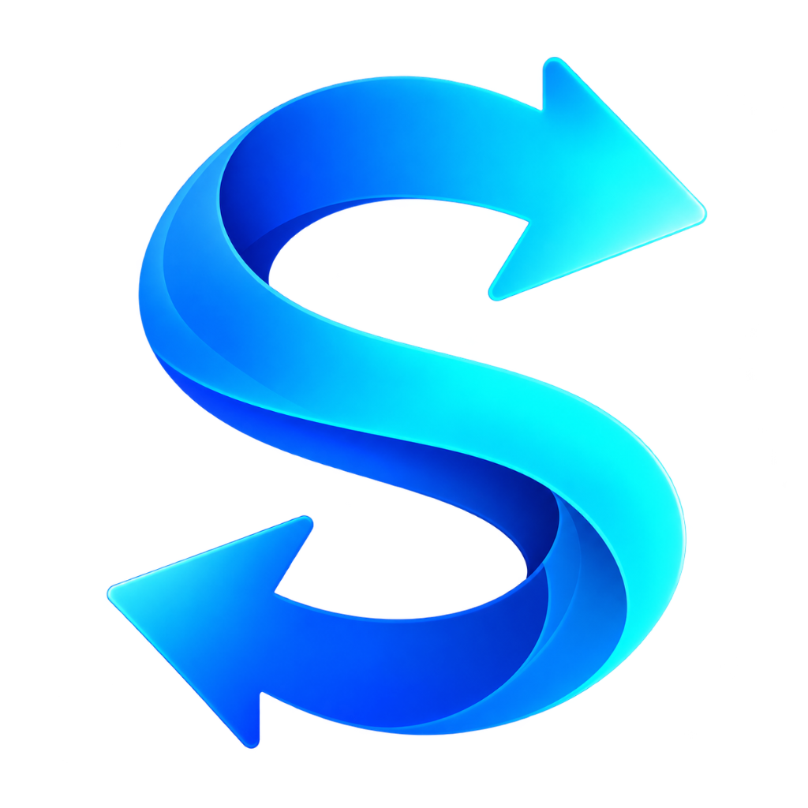
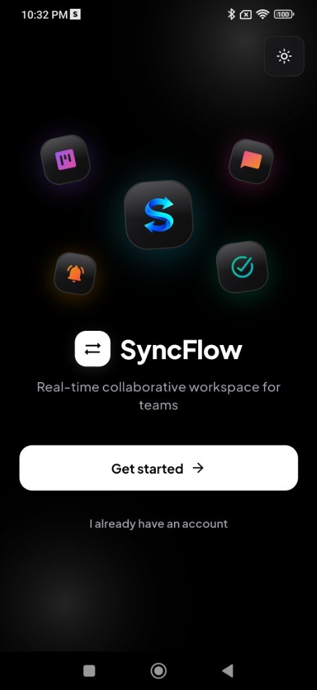
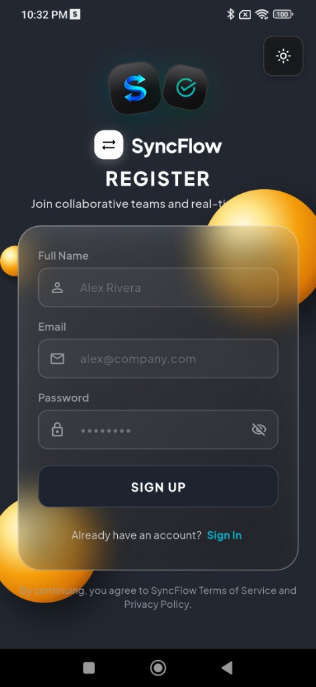
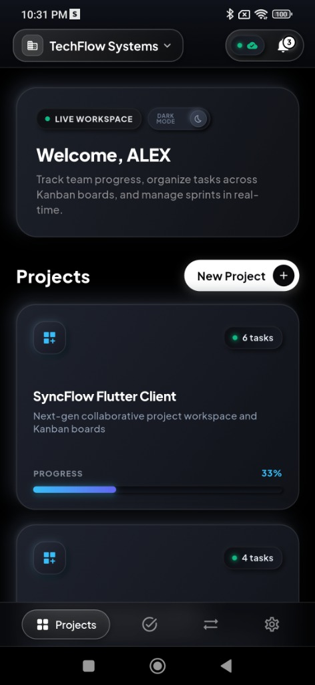
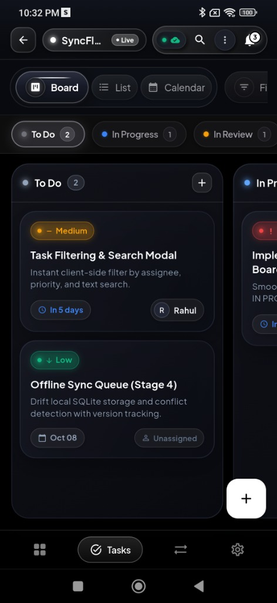
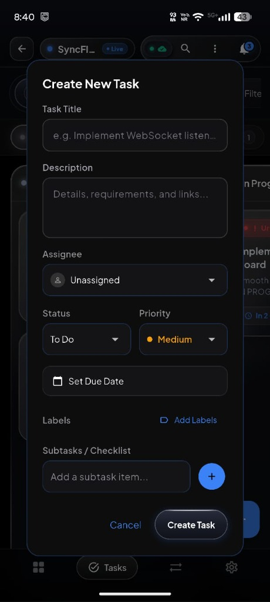
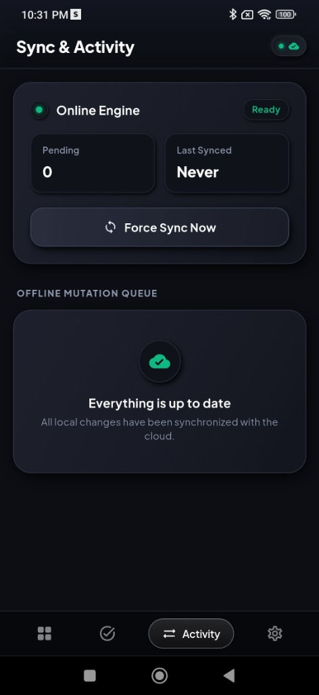

<p align="center">
  
</p>

<h1 align="center">SyncFlow</h1>

<p align="center">
  <strong>Next-Gen Real-Time Collaborative Workspace • Neumorphic Kanban • Offline-First Sync</strong>
</p>

<p align="center">
  <a href="https://flutter.dev"></a>
  <a href="https://riverpod.dev"></a>
  <a href="https://supabase.com"></a>
  <a href="https://www.postgresql.org"></a>
  <a href="LICENSE"></a>
</p>

---

## 📖 Overview

**SyncFlow** is an enterprise-grade project collaboration and task management platform built with **Flutter**, **Riverpod**, and **Supabase**. Crafted with a tactile **Neumorphic (Soft UI)** design system, SyncFlow delivers physical depth, specular lighting physics, and fluid micro-animations alongside high-performance drag-and-drop Kanban workflows, multi-workspace tenancy, and real-time multi-device cloud synchronization.

---

## 📱 Live App Screenshots & Interface Showcase

<p align="center">
  
  &nbsp;
  
  &nbsp;
  
</p>
<p align="center">
  <em><b>Welcome Screen</b> (3D Floating Tiles) &nbsp;•&nbsp; <b>Register Screen</b> (Glassmorphic) &nbsp;•&nbsp; <b>Projects Dashboard</b> (Neumorphic)</em>
</p>

<br />

<p align="center">
  
  &nbsp;
  
  &nbsp;
  
</p>
<p align="center">
  <em><b>Kanban Board</b> (Multi-Column Drag & Drop) &nbsp;•&nbsp; <b>Create Task Modal</b> (Tactile Wells) &nbsp;•&nbsp; <b>Sync & Activity</b> (Offline Queue)</em>
</p>

---

## 🎨 Design System & Color Palette

SyncFlow features a custom **Tactile Neumorphic Engine** built directly on Vanilla Flutter shaders and multi-directional box shadows, avoiding generic flat UI in favor of extruded surfaces and recessed input wells.

### 🌗 Theme Surfaces & Lighting Physics

| Token Name | Hex Code | Swatch | Purpose & Behavior |
| :--- | :---: | :---: | :--- |
| **Dark Base (Matte Obsidian)** | `#13161F` |  | Primary dark canvas background |
| **Dark Surface Top** | `#181C27` |  | Specular top-left light incidence for convex cards |
| **Dark Surface Bottom** | `#0F121A` |  | Deep shadow falloff on bottom-right |
| **Dark Sunken Top (Pressed)** | `#0B0D13` |  | Inverted inner shadow for recessed inputs & wells |
| **Dark Sunken Bottom (Pressed)**| `#161923` |  | Deep bottom basin for text wells & dropdowns |
| **Light Base (Porcelain Slate)** | `#E8EEF5` |  | Soft ceramic light mode canvas |
| **Light Surface Top** | `#F3F7FD` |  | Elevated sunlight reflection |
| **Light Surface Bottom** | `#DFE6F1` |  | Gentle slate ambient shadow |
| **Light Sunken Top (Pressed)** | `#D6DEEB` |  | Recessed groove shadow for light mode |
| **Light Sunken Bottom (Pressed)**| `#EDF2F9` |  | Crisp interior reflective rim |

---

### 🌈 Brand & Status Accents

| Accent Token | Hex Code | Swatch | Application |
| :--- | :---: | :---: | :--- |
| **Electric Azure (Primary)** | `#0096FF` / `#3B82F6` |  | Primary brand CTA, active tabs, glowing buttons |
| **Cyan Orbit Flow** | `#00D2FF` / `#06B6D4` |  | Launch rings, active sync indicators, quick badges |
| **Emerald Success** | `#10B981` |  | Completed (`DONE`) tasks, low priority, health metrics |
| **Amber Warning** | `#F59E0B` |  | Medium priority, review queue, due soon warnings |
| **Rose Crimson (Urgent)** | `#EF4444` |  | Urgent priority, blocked items, destructive actions |
| **Violet Insight** | `#8B5CF6` |  | High priority, AI copilot badges, activity logs |

---

### 💎 Neumorphic Interactive Components

```
┌──────────────────────────────────────────────────────────┐
│  Convex (Extruded Surface): Light from Top-Left          │
│  ┌────────────────────────────────────────────────────┐  │
│  │  NeumorphicContainer (elevation, specular rims)    │  │
│  │                                                    │  │
│  │  Concave (Sunken Well): Inverted Inner Depression  │  │
│  │  ┌──────────────────────────────────────────────┐  │  │
│  │  │  Text Inputs, Dropdowns, Date Pickers        │  │  │
│  │  └──────────────────────────────────────────────┘  │  │
│  │                                                    │  │
│  │  Physical Button: Sinks on Tap (Scale: 0.98)       │  │
│  │  [  Create Task  ]  [  Cancel  ]                   │  │
│  └────────────────────────────────────────────────────┘  │
└──────────────────────────────────────────────────────────┘
```

1. **`NeumorphicContainer`**: Dual-directional lighting engine supporting convex elevated podiums and sunken concave wells.
2. **`NeumorphicButton`**: Spring physics with tactile press depression (`scale: 0.98`) and specular rim illumination.
3. **`NeumorphicIconButton`**: Tactile circular and squircle action triggers with glowing accent states.
4. **`NeumorphicSwitch`**: Recessed channel track with an extruded ceramic knob and smooth sliding interpolation.
5. **`NeumorphicPill`**: Micro-embossed indicator chips for task tags, roles, and status counts.
6. **`NeumorphicSegmentedControl`**: Recessed groove switcher with an elevated sliding pill indicator.

---

## 🎬 Opening Animation & App Identity

SyncFlow opens with a **Cinematic Launch Sequence**:
- **Dual Rotating Sync Rings**: Concentric glowing cyan and azure orbit rings counter-rotate around the 3D logo with illuminated node particles, symbolizing real-time synchronization.
- **Floating Neumorphic Podium**: The official 3D rotating arrow "S" logo rests on an extruded circular pedestal with specular rim lighting and ambient blue aura.
- **Elastic Pop & Surface Shimmer**: Logo scales in with an elastic bounce (`Curves.elasticOut`), followed by a specular shimmer wave traversing its curves.
- **Sleek Progress Track**: Recessed Neumorphic pill bar with an animated moving light beam.
- **Smart Handoff**: Auto-navigates after 2.3 seconds (or instant jump on tap) to `/projects` for authenticated members or `/welcome` for onboarding.

---

## ⚡ Key Features

### 🏢 1. Multi-Workspace Tenancy & RBAC
- Instant workspace switching with zero reloads.
- Role-based permissions: `Owner`, `Admin`, `Member`, `Viewer`.
- Real-time active member presence bar with animated avatar overlays.

### 📋 2. Multi-View Workspace
- **Kanban Board**: Dynamic 4-column workflow (`TODO`, `IN PROGRESS`, `IN REVIEW`, `DONE`) with smooth drag-and-drop task reordering.
- **Interactive List View**: Multi-column list with instant sort by Due Date, Priority, Status, or Title, plus one-tap status cycling.
- **Monthly Calendar View**: Interactive month grid with color-coded task markers, today indicator, and selected-date quick-add prefill.

### 💬 3. Rich Task Cards & Discussions
- **Checklists & Subtasks**: Interactive progress trackers with instant completion toggles.
- **Threaded Discussions**: Nested comment hierarchy with replies.
- **Audit Activity Feed**: Chronological activity timeline recording all edits, moves, and assignments.
- **Custom Label Taxonomy**: Multi-color label tagging with Kanban filter bar.

### ⏱️ 4. Stopwatch & Time Tracking
- Live digital stopwatch with Start, Pause, Resume, and Stop & Save controls.
- Manual work logger with duration and notes.
- Per-task total logged duration banner and history timeline with author tags.

### 🤖 5. SyncFlow AI Copilot
- **1-Click Task Breakdown**: Auto-generates actionable checklist items tailored to task context (Auth, Backend, UI/UX, Bugfix).
- **Task Health & Velocity Analysis**: Computes risk flags, progress metrics, and recommends priority adjustments.
- **Project Feature Ideation**: Intelligent backlog brainstorming with instant task creation.

### 🌐 6. Real-Time Cloud Sync & Offline-First Engine
- **Supabase Realtime (CDC)**: Instant multi-device synchronization over WebSockets. Card updates reflect on team members' devices with 0ms manual refresh.
- **Offline Mutation Queue**: Local FIFO queue captures edits made without internet, seamlessly draining and reconciling conflicts upon reconnection.

---

## 🏛️ Architecture & Project Structure

SyncFlow follows **Clean Architecture** with a modular **Feature-First** layout:

```text
sync_flow/
├── assets/
│   └── images/
│       └── logo.png                   # Official 3D SyncFlow identity
├── lib/
│   ├── main.dart                      # Preloads SharedPreferences & initializes Supabase
│   ├── app.dart                       # MaterialApp.router with dynamic theme & accent colors
│   ├── core/
│   │   ├── config/                    # Environment variables & SharedPreferences providers
│   │   ├── constants/                 # AppColors, typography, layout tokens
│   │   ├── router/                    # GoRouter with /splash, auth guards & deep links
│   │   ├── theme/                     # Material 3 Light/Dark themes & accent palette
│   │   └── widgets/                   # Neumorphic Design System (Container, Button, Pill, etc.)
│   └── features/
│       ├── auth/                      # Authentication (Login, Register, Mock / Supabase Auth)
│       ├── workspaces/                # Workspaces (Listing, Switcher Sheet, Creation Dialog)
│       ├── projects/                  # Project list, color customization, creation flow
│       ├── tasks/                     # Kanban board, List, Calendar views, Task Dialogs
│       ├── members/                   # Team member management & invitations
│       ├── notifications/             # Notification center & unread triggers
│       ├── settings/                  # Neumorphic Settings, Theme Mode, Profile editing
│       └── splash/                    # Cinematic opening launch screen & animation
├── supabase/
│   └── schema.sql                     # Production PostgreSQL schema (14 tables, RLS, triggers)
└── test/                              # Comprehensive unit and widget tests
```

---

## 🚀 Getting Started

### Prerequisites

- [Flutter SDK](https://flutter.dev/docs/get-started/install) (`>= 3.8.0`)
- Android Studio / VS Code / Antigravity IDE
- Physical Android/iOS device or emulator

### 1. Clone & Install Dependencies

```bash
git clone https://github.com/LOHITHKUMARN/Sync_Flow.git
cd "Sync_Flow"
flutter pub get
```

### 2. Run in Local / Mock Mode (Zero Setup Required)

SyncFlow runs out of the box with zero cloud setup using its local mock repository engine:

```bash
flutter run
```

---

## 🌐 Connecting to Live Supabase Backend

SyncFlow contains full dual-mode support: it automatically switches from Mock mode to live Supabase cloud database when credentials are provided.

### Step 1: Deploy Database Schema
1. Create a project at [supabase.com](https://supabase.com).
2. Open the **SQL Editor** in your Supabase dashboard.
3. Paste and run the entire script in [`supabase/schema.sql`](supabase/schema.sql).
   *(This provisions all 14 tables, Row Level Security policies, realtime publications, and auth triggers).*

### Step 2: Launch with Credentials

Run the app passing your project URL and public Anon Key:

```powershell
flutter run `
  --dart-define=SUPABASE_URL=https://YOUR_PROJECT_ID.supabase.co `
  --dart-define=SUPABASE_ANON_KEY=YOUR_SUPABASE_ANON_KEY
```

---

## 📦 Building Standalone Release APK

Generate an installable release APK for Android devices:

```powershell
flutter build apk --release `
  --dart-define=SUPABASE_URL=https://YOUR_PROJECT_ID.supabase.co `
  --dart-define=SUPABASE_ANON_KEY=YOUR_SUPABASE_ANON_KEY
```

The APK will be generated at:
```text
build/app/outputs/flutter-apk/app-release.apk
```

---

## 🧪 Testing & Code Quality

Verify static analysis and test suites:

```bash
# Run Flutter analyzer
flutter analyze

# Run unit & widget test suite
flutter test
```

---

## 📄 License

This project is licensed under the MIT License — see the [LICENSE](LICENSE) file for details.
